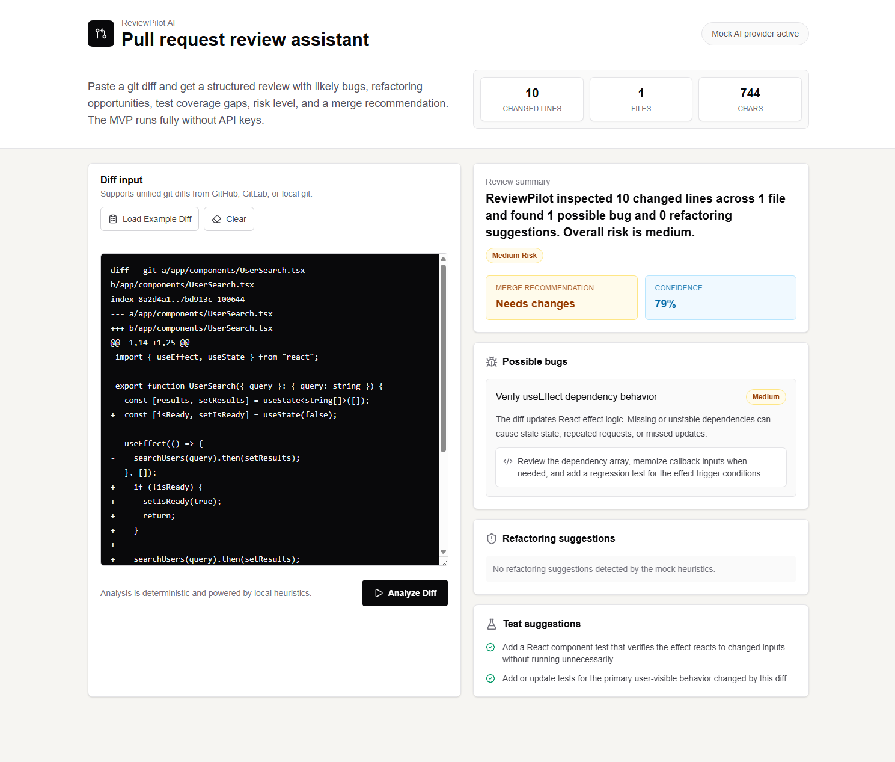

# ReviewPilot AI

**Turn a git diff into a structured code review, locally or in a GitHub pull request.**

[](https://github.com/JohnImril/reviewpilot-ai/actions/workflows/ci.yml)
[](./LICENSE)

ReviewPilot AI is an open-source PR review assistant for developers working with
React and TypeScript. Paste a unified diff to get findings with file and line
references, suggested fixes, test ideas, and an explained risk score. Run the
deterministic demo without API keys, connect OpenAI for model-generated reviews,
or configure a GitHub App to post reports on your pull requests.

**[Try the live demo](https://reviewpilot-ai-lime.vercel.app/)** ·
**[Browse example reports](https://reviewpilot-ai-lime.vercel.app/examples)** ·
**[Run locally](#quick-start)** ·
**[Set up the GitHub App](./docs/github-app-setup.md)**

> **Current stage: working MVP.** The default provider uses local, rule-based
> heuristics, not an LLM. OpenAI reviews are available when configured on your
> own deployment. Review output is advisory; the app does not approve or merge PRs.

[](https://reviewpilot-ai-lime.vercel.app/examples)

## Try a review

1. Open the [demo](https://reviewpilot-ai-lime.vercel.app/).
2. Click **Load Example Diff**, then **Analyze Diff**. No account or API key is needed.
3. Inspect the findings, their locations, and the factors behind the risk score.
   Click **Load Example Diff** again to try the next scenario.

Bundled examples cover React effect dependencies, weak TypeScript typing,
frontend rendering costs, and dependency changes. The
[Examples page](https://reviewpilot-ai-lime.vercel.app/examples) shows prepared
mock reports without submitting a diff.

Use the bundled examples or a public diff on the hosted demo. For private code,
run your own instance and choose where the review is processed.

## What you get

| Capability                       | What it helps you do                                                     |
| -------------------------------- | ------------------------------------------------------------------------ |
| File and line references         | Go from a finding to the changed code and a suggested fix.               |
| Four review modes                | Focus on General, React, TypeScript, or Frontend Performance concerns.   |
| Explained risk score             | Inspect the factors contributing to a score from 0 to 100.               |
| Test suggestions                 | Turn review findings into cases to verify before merging.                |
| GitHub App integration           | Create or update one report comment on PR open, reopen, and new commits. |
| Validated JSON API               | Reuse the review result in another UI or workflow.                       |
| Deterministic examples and evals | Explore the pipeline and check regressions without model costs.          |

The project is useful for trying a first review pass on a diff or building your
own review workflow. The parser, provider interface, Zod schemas, and GitHub
integration are available to inspect and extend under the MIT license.

## Quick start

Use **[Node.js 24 LTS](https://nodejs.org/en/about/previous-releases)**, npm, and Git.

```bash
git clone https://github.com/JohnImril/reviewpilot-ai.git
cd reviewpilot-ai
npm ci
npm run dev
```

Open [localhost:3000](http://localhost:3000) and click **Load Example Diff**,
then **Analyze Diff**. On a fresh clone, no `.env` file, database, GitHub App,
or API key is required: the default provider is `mock`.

To review your own changes, run one of these commands in the repository you
want to review, then paste its output into ReviewPilot:

```bash
git diff                 # Unstaged changes in tracked files
git diff --cached        # Staged changes, including staged new files
git diff main...HEAD     # Branch changes; replace main with your base branch
```

See the [setup and troubleshooting guide](./docs/getting-started.md) for
environment variables, Windows instructions, and common errors.

## Choose how reviews run

|                         | Mock (default)                                        | OpenAI (opt-in)                                                      |
| ----------------------- | ----------------------------------------------------- | -------------------------------------------------------------------- |
| How it works            | Deterministic rules over the parsed diff              | A model reviews the diff and parsed metadata                         |
| Configuration           | None on a fresh clone                                 | `AI_PROVIDER=openai` and `OPENAI_API_KEY`                            |
| External model requests | None                                                  | Diff and metadata are sent to OpenAI                                 |
| Best use                | Exploring the workflow, development, repeatable tests | Trying model-generated reviews on your own instance                  |
| Limits                  | Pattern checks can flag correct code or miss bugs     | Output can vary or be incorrect; API usage is billed by the provider |

For OpenAI reviews, create `.env.local` in the project root:

```dotenv
AI_PROVIDER=openai
OPENAI_API_KEY=your_api_key
OPENAI_MODEL=your_model_id
```

Replace the placeholders with your key and a model available to your account
that supports Chat Completions with JSON object output, then restart the server.
The current provider calls OpenAI directly; custom API base URLs and other model
vendors are not configurable. See [provider configuration](./docs/getting-started.md#use-openai)
for defaults and error behavior.

For PR comments, follow the [GitHub App setup guide](./docs/github-app-setup.md).
The App fetches the diff, runs a General review using your configured provider,
and updates its report after new commits. It does not clone the repository or
execute PR code.

## Example finding

For the bundled React search example, mock mode flags an added network request:

> **Network request needs failure handling** · medium severity
>
> `app/components/UserSearch.tsx:9`
>
> `fetch("/api/users?query=" + query)`
>
> **Suggested fix:** Add try/catch, check response status, and expose loading and
> failure states close to the request flow.

This is a review prompt for a human to check, not proof of a bug. The
[API guide](./docs/example-output.md) includes a runnable request and the full
deterministic response.

## Documentation

| Guide                                              | Contents                                                      |
| -------------------------------------------------- | ------------------------------------------------------------- |
| [Getting started](./docs/getting-started.md)       | Local setup, providers, configuration, troubleshooting        |
| [GitHub App setup](./docs/github-app-setup.md)     | Permissions, installation, webhook testing, deployment limits |
| [API and example output](./docs/example-output.md) | Request format, modes, a reproducible response, errors        |
| [Architecture](./docs/architecture.md)             | Parser, shared review service, providers, GitHub flow         |
| [Prompt design](./docs/prompt-design.md)           | Model instructions and response validation                    |
| [Evaluation guide](./evals/README.md)              | Golden cases, mock checks, opt-in real-provider evals         |
| [Contributing](./CONTRIBUTING.md)                  | First contributions, development commands, pull requests      |

Built with Next.js 16, React 19, TypeScript, Tailwind CSS 4, Zod, and Vitest.

## Current limits and next steps

- Reviews see the submitted diff, not the full repository or runtime behavior.
  Risk scores and confidence values are not measured probabilities of correctness.
- The manual API accepts up to 120,000 characters. GitHub PR diffs default to a
  100,000-character limit; oversized PRs receive a notice instead of a partial review.
- The GitHub App runs synchronously and uses best-effort delivery deduplication.
  Durable queues and atomic shared storage are needed for reliable multi-instance use.
- Authentication, rate limiting, saved history, inline annotations, and Check
  Runs are not included. Protect a public deployment before enabling a paid provider.

Useful next steps are reducing false positives with more evaluation cases,
making webhook processing durable, and adding repository context and inline
findings. These are planned directions, not available features or promised dates.

## Contribute or share feedback

Found a false positive or a missed issue? [Open an issue](https://github.com/JohnImril/reviewpilot-ai/issues/new/choose)
with a small, sanitized diff and the expected finding. Reproducible examples are
especially helpful for improving review quality.

First contributions can include a regression case, a setup clarification, or a
reproducible bug report. Start with [CONTRIBUTING.md](./CONTRIBUTING.md).

If ReviewPilot is useful to you, a GitHub star helps you find it again and lets
the maintainer know the project is worth continuing.

## License

[MIT](./LICENSE).
